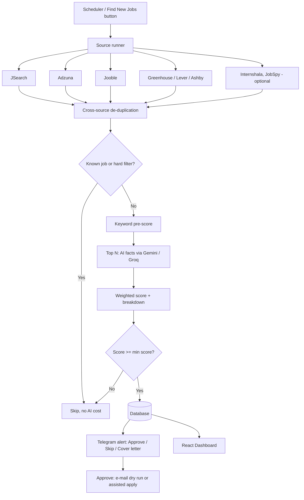

# 🚀 Job Application Autopilot

### AI-Powered Job Discovery, Matching & Application Management

An AI-powered full-stack application that automates job discovery, evaluates opportunities based on a candidate's profile, generates personalized cover letters, and organizes relevant jobs in a centralized dashboard.

The whole workflow runs **natively in the Python backend** (FastAPI + several job sources + Gemini/Groq + Telegram), with a React dashboard on top. Version 2 adds multiple job sources with health tracking, cross-source de-duplication, an explainable score computed in code, Telegram approve/skip buttons, and safe applying (dry-run by default). The old Make.com endpoints are kept for backwards compatibility.

---

## ✨ Features

- 🔎 **Multi-source discovery:** JSearch, Adzuna India, Jooble India, company career boards (Greenhouse, Lever, Ashby) and, optionally, Internshala and Indeed/LinkedIn (experimental, off by default). Each source is isolated, retried, health-tracked and budgeted (JSearch: 150 of 200 free requests per month).
- 🧬 **Cross-source de-duplication:** the same opening from several sources becomes one job that remembers every source and keeps the richest description.
- 🧮 **Explainable scoring:** a 0-10 score computed in code from five weighted parts (skills, role fit, experience, preferences, freshness). AI only extracts facts (verified against the posting text). Each job shows a breakdown with matched and missing skills.
- 🧱 **Hard filters:** experience, location, job type, blocked companies and keywords, before any AI cost.
- 🤖 **AI provider fallback:** Gemini, then Groq, then OpenRouter; rate limits and outages fall through automatically. Only the top jobs per run use AI (cost control).
- ✍️ **Personalized cover letters:** written for qualifying jobs, or on demand from Telegram.
- 📬 **Telegram approvals:** alerts with Approve / Skip / Cover letter buttons (webhook or local polling); only your chat is obeyed.
- 📮 **Safe applying:** after approval, e-mail the recruiter (dry-run by default, daily cap) or get an assisted apply (link + cover letter ready). Every attempt is logged.
- 📈 **Learning:** after 30+ decisions, suggests new score weights from what you approve (guard-railed, applied only on request).
- 🗄️ **Migrations:** Alembic; existing V1 databases upgrade in place on startup.
- 🔁 **Resilient:** retries with backoff, a run survives a failing source, the API starts even when the database is down (`/api/health`).
- 📊 **Dashboard & Analytics:** live run results, funnel, score distribution, jobs over time, top companies and sources; filters incl. decision status; CSV export.
- 🧩 **Resume fit & skill gaps:** one-click AI analysis of your resume against any job.
- 📄 **Tailored resume per job:** for jobs scoring below 9 (configurable), the AI re-orders and re-words your resume for that posting. Every skill, employer, title, date and number is checked against your original, anything unverifiable is removed, and the job is re-scored with the same engine (before and after, with the real gaps). It never invents experience and never promises a score. Download as PDF or Word.
- 📝 **Career-page form pre-fill:** for Greenhouse, Lever and Ashby postings a Playwright browser fills your details, uploads the resume, pastes the cover letter and takes a screenshot. It stops before Submit unless you explicitly enable submitting, leaves custom, legal and diversity questions to you, and hands over at a CAPTCHA.
- ⏱️ **Live job search:** the Find New Jobs button opens a progress panel (fetch, merge, filter, score, save) with a row per source and a counter of new jobs; lists update as jobs arrive.
- 📤 **Export:** download jobs as CSV, Excel or PDF.
- 👤 **Accounts and privacy:** everyone signs in and sees only their own jobs, resumes, settings, applications and Telegram alerts. The first account keeps any data that existed before. A profile page holds contact details, Telegram linking, password and account deletion.
- 🗺️ **Workflow map:** `frontend/public/workflow.html` is an interactive, n8n-style map of the whole system (nodes, connections, sources, keys and where to set them, guided walkthrough). Open it from the sidebar ("Workflow map"), at `/workflow.html` on the running site, or by double-clicking the file.
- 🗂️ **Application tracking:** To Apply through Offer/Rejected.

> Applying only happens after you approve a job, and e-mail applications are dry-run until you set `APPLY_DRY_RUN=false`. Logged-in automation on LinkedIn, Naukri or Internshala is deliberately not supported.

---

## 🏗️ System Architecture



### How It Works

1. **Trigger:** the scheduler or the dashboard's "Find New Jobs" button starts a run (one at a time, 2-minute cooldown).
2. **Discovery:** every enabled source is queried independently; failures are recorded per source.
3. **De-duplication:** listings of the same job across sources are merged; jobs already in the database are only marked as seen again.
4. **Hard filters:** experience, location, job type and blocked companies/keywords.
5. **Scoring:** a keyword pre-score for all jobs; the top 15 get AI-extracted facts; the final score is computed in code with a breakdown.
6. **Storage & alerts:** qualifying jobs are saved and sent to Telegram with buttons.
7. **Approve / Skip:** from Telegram or the dashboard. Approving starts the safest apply method and every decision becomes training data for the weights.

---

## 🛠️ Tech Stack

| Category | Technologies |
|---|---|
| Frontend | React, Vite, JavaScript, CSS |
| Backend | Python, FastAPI |
| Database | SQLite (local) / PostgreSQL (production), SQLAlchemy, Alembic migrations |
| AI / LLM | Google Gemini (configurable model), Groq (OpenAI-compatible), optional OpenRouter |
| Job Data | JSearch, Adzuna, Jooble, Greenhouse / Lever / Ashby boards, optional Internshala and JobSpy |
| Notifications | Telegram Bot API |
| API Communication | REST API, HTTP, JSON |
| Authentication | Optional admin key for approve/apply endpoints; API key for legacy machine endpoints |
| Deployment | Render (backend), Vercel (frontend) |
| Version Control | Git, GitHub |

---

## 📁 Project Structure

```text
Job-Application-Autopilot/
│
├── backend/
│   ├── main.py            # FastAPI app & endpoints
│   ├── crud.py            # Database operations
│   ├── models.py / schemas.py / database.py
│   ├── alembic/           # database migrations (run automatically on startup)
│   ├── services/
│   │   ├── pipeline.py             # Automation orchestrator + run status
│   │   ├── sources/                # Job source plugins, registry, runner (budgets, health)
│   │   ├── dedupe.py, geo.py, matching.py   # De-duplication, locations, role similarity
│   │   ├── scoring/                # Profile, facts, filters, score engine, weights, tuning, cover letters
│   │   ├── llm/                    # AI provider layer (Gemini, Groq, OpenRouter)
│   │   ├── telegram_bot.py         # Approve / Skip / Cover letter buttons
│   │   ├── apply/                  # Safe applying (e-mail dry-run, assisted)
│   │   ├── ai_service.py           # Gemini calls, fit analysis
│   │   ├── jsearch_service.py      # JSearch client
│   │   ├── notification_service.py # Telegram messages
│   │   ├── analytics.py            # Stats aggregation & CSV export
│   │   └── retry.py                # Retry with exponential backoff
│   ├── test_*.py          # Offline test scripts; run_tests.py runs them all
│   └── requirements.txt
│
├── frontend/
│   ├── src/
│   ├── public/
│   ├── package.json
│   └── ...
│
├── docs/
│
├── .gitignore
└── README.md
```

---

## ⚙️ Getting Started

### 1. Clone the Repository

```bash
git clone https://github.com/STARBORN-10/Job-Application-Autopilot.git
cd Job-Application-Autopilot
```

### 2. Set Up the Backend

```bash
cd backend
python -m venv .venv
```

Activate the virtual environment.

**Windows:**

```powershell
.venv\Scripts\activate
```

**macOS / Linux:**

```bash
source .venv/bin/activate
```

Install dependencies:

```bash
pip install -r requirements.txt
```

Optional (Indeed/LinkedIn scraping and career-page form filling):

```bash
pip install -r requirements-optional.txt
playwright install chromium
```

### 3. Configure Environment Variables

Copy `backend/.env.example` to `backend/.env` and fill in your keys:

```env
DATABASE_URL=sqlite:///./jobs.db
RAPIDAPI_KEY=...              # JSearch
ADZUNA_APP_ID=...
ADZUNA_APP_KEY=...
JOOBLE_API_KEY=...
GEMINI_API_KEY=...            # and/or GROQ_API_KEY (at least one AI key)
GROQ_API_KEY=...
TELEGRAM_BOT_TOKEN=...        # alerts + Approve/Skip buttons
TELEGRAM_CHAT_ID=...
TELEGRAM_WEBHOOK_SECRET=...   # for the webhook (or TELEGRAM_MODE=polling locally)
ADMIN_API_KEY=...             # recommended: protects approve/skip/apply
APPLY_DRY_RUN=true            # default; nothing is e-mailed until false + SMTP_* are set
AUTO_RUN_INTERVAL_MINUTES=0   # optional scheduler
```

See `backend/.env.example` and [docs/deployment.md](docs/deployment.md) for every variable (SMTP, budgets, models, cooldowns).

Then upload a resume for your active role on the **Resumes** page and click **Find New Jobs** on the Dashboard.

**Never upload real API keys, tokens, or credentials to GitHub.**

### Run it on your own computer

See **[docs/RUN_LOCALLY.md](docs/RUN_LOCALLY.md)** for copy-and-paste commands for every step, including accounts, the workflow map and Telegram.

### Run the Tests

The tests are offline scripts (no live API calls; HTTP, Telegram and SMTP are mocked). From `backend/`:

```bash
python run_tests.py          # runs every test_*.py and prints a pass count per suite
python test_pipeline.py      # or any single suite
```

### 4. Run the Backend

From the `backend` directory:

```bash
uvicorn main:app --reload
```

Backend URL:

```text
http://127.0.0.1:8000
```

Interactive API documentation:

```text
http://127.0.0.1:8000/docs
```

### 5. Run the Frontend

Open a separate terminal:

```bash
cd frontend
npm install
npm run dev
```

Open the local development URL provided by Vite, usually:

```text
http://localhost:5173
```

Make sure the frontend is configured to use the intended backend API URL.

---

## 🔌 API Endpoints

The FastAPI backend provides REST endpoints for job management.

| Method | Endpoint | Description |
|---|---|---|
| GET | `/api/jobs` | Retrieve job listings with score and status filters |
| POST | `/api/jobs` | Ingest qualified job (API key, duplicate detection & experience guard) |
| GET | `/api/jobs/{id}` | Retrieve specific job details |
| PUT | `/api/jobs/{id}` | Update job status ('Applied', 'Interview', etc.) |
| DELETE | `/api/jobs/{id}` | Delete job record |
| GET | `/api/make/context` | *Deprecated* legacy ingestion endpoint: active role, resume text and filters (API key required) |
| GET | `/api/make/resume` | *Deprecated* legacy ingestion endpoint: resume text for a role (API key required) |
| GET | `/api/resumes` | List all uploaded resumes across all roles |
| POST | `/api/resumes` | Upload new PDF resume and associate with target role |
| PUT | `/api/resumes/{id}/activate` | Select active resume for a specific role |
| PUT | `/api/resumes/{id}/replace` | Replace uploaded PDF file for an existing resume |
| GET | `/api/resumes/{id}/text` | Preview plain text extracted from a resume PDF |
| DELETE | `/api/resumes/{id}` | Delete a resume and its PDF from disk |
| GET | `/api/settings` | Retrieve unified job search & automation settings |
| PUT | `/api/settings` | Update settings (roles, min score, locations, experience filters) |
| POST | `/api/automation/trigger` | Start the pipeline in the background (`already_running` if busy; 429 within the cooldown) |
| GET | `/api/automation/status` | Running flag, last run summary (per-source counts, merges; survives restarts) and source health |
| GET | `/api/analytics?days=30` | Funnel, score distribution, jobs-over-time, top companies, sources |
| GET | `/api/export/jobs.{csv,xlsx,pdf}` | Download jobs as CSV, Excel or PDF |
| GET | `/api/jobs/top` | Highest-scoring jobs first (ties: newest); hides skipped/rejected |
| POST | `/api/jobs/{id}/analyze` | AI skill-gap analysis of the active resume vs. this job |
| GET | `/api/health` | Liveness + database check (503 when the database is unreachable) |
| GET | `/api/sources` | Sources with enabled / configured / experimental flags and health |
| PUT | `/api/sources/{name}` | Enable or disable a source (`{"enabled": true}`) |
| GET / PUT | `/api/settings/ats-companies` | Company career boards to watch (Greenhouse / Lever / Ashby) |
| GET | `/api/ai/providers` | AI providers in fallback order and their models (no keys) |
| GET / PUT | `/api/scoring/weights` | Score weights (must add up to 100) |
| POST | `/api/scoring/tune?apply=false` | Suggest weights from decisions (admin key) |
| POST | `/api/jobs/{id}/approve`, `/api/jobs/{id}/skip` | Decide on a job (admin key); approving starts the apply step |
| POST | `/api/jobs/{id}/apply` | Retry applying for an approved job (admin key) |
| GET | `/api/applications`, `/api/applications/config` | Application log; dry-run flag, daily cap, SMTP status |
| GET | `/api/jobs/{id}/approve-preview`, `/api/jobs/{id}/timeline` | What Approve will do for this job; the job's history |
| POST | `/api/jobs/{id}/tailor-resume` | Tailor the resume for this job (skipped at score >= 9; admin key) |
| GET | `/api/jobs/{id}/tailored-resume`, `.pdf`, `.docx` | Tailored resume data (null if none yet) and downloads |
| POST | `/api/jobs/{id}/prefill` | Pre-fill the Greenhouse / Lever / Ashby form; never submits by default (admin key) |
| GET | `/api/tasks/{id}`, `/api/applications/{id}/screenshot` | Background task progress; screenshot of the pre-filled form |
| GET / PUT | `/api/settings/applicant-profile` | Name, email, phone and links used to fill forms |
| GET | `/api/sources/summary`, `/api/autofill/config` | Jobs per source; autofill mode and whether Playwright is installed |
| POST | `/api/telegram/webhook` | Telegram updates (secret header required) |
| POST | `/api/telegram/set-webhook` | Register the webhook with Telegram (admin key) |

`GET /api/jobs` also accepts `approval_status=pending|approved|skipped`. "Admin key" means the `X-Admin-Key` header, required only when `ADMIN_API_KEY` is set.

For hosting and cloud persistence guidelines, see [Production Deployment Guide](docs/deployment.md).

### Example: Create a Job

**Request:**

```http
POST /api/jobs
Content-Type: application/json
x-api-key: YOUR_API_KEY
```

**Request Body:**

```json
{
  "title": "Data Analyst Intern",
  "company": "Example Company",
  "url": "https://example.com/job",
  "location": "India",
  "description": "Analyze business data and generate insights.",
  "job_type": "Internship",
  "experience": "Fresher",
  "source": "IndianAPI",
  "score": 8.5,
  "match_reason": "Strong alignment with Python and SQL skills.",
  "cover_letter": "Personalized cover letter content.",
  "status": "To Apply"
}
```

---

## 🧠 Job Matching (explainable score)

The score (0-10) is computed in code, not guessed by an AI. Five parts, each between 0 and 1, are weighted (defaults below, editable in Settings, must add up to 100):

| Part | Weight | What it measures |
|---|---|---|
| Skills | 40 | Share of the posting's required skills found in your resume (aliases and fuzzy matching; nice-to-have count half) |
| Role fit | 20 | Job title vs. your active role and the roles your resume targets |
| Experience | 15 | Required years / seniority vs. your experience and maximum |
| Preferences | 15 | Location (remote handled) and preferred job type |
| Freshness | 10 | How recently the job was posted |

AI (Gemini or Groq) extracts the facts for the top jobs of a run, and a structured profile once per resume version. Skills the posting does not mention are discarded. When only a short snippet is available (Adzuna, Jooble, Internshala), the skills part counts for less. A title that does not fit your roles caps the score at 6.5. The breakdown (bars, matched and missing skills) is shown on each job.

Only jobs at or above your minimum match score (default 7) are saved and alerted.

---

## 🔐 Security and Data Handling

- Secrets live in environment variables (`backend/.env` locally); they are redacted from stored errors and never returned by the API.
- `ADMIN_API_KEY` (optional) protects approve/skip/apply, Telegram webhook registration and weight tuning. A key placed in the frontend build is readable by anyone who can load the site.
- Accounts: passwords are salted scrypt hashes, sessions are signed tokens that end when the password changes, sign-in is rate limited, and the database session itself filters every query to the signed-in user (`backend/tenancy.py`), so no endpoint can leak another person's data. A test sweeps every route to make sure none is open without a sign-in.
- Uploaded resume PDFs are private to their owner (they used to be publicly downloadable under `/uploads`).
- The Telegram webhook requires the `TELEGRAM_WEBHOOK_SECRET` header; each person's taps only act on their own jobs.
- Real e-mail applications use the server's SMTP account, so only the owner account may send them; everyone else stays in dry run.
- The trigger endpoint has a cooldown because every run spends API quota.
- E-mail applying is dry-run by default and capped per day; nothing is applied for without approval.
- Scraped sources use public pages only, at low volume, and are off by default.

---

## ☁️ Deployment

The backend is deployed on Render.

- **Backend:** https://job-application-autopilot.onrender.com
- **API Documentation:** https://job-application-autopilot.onrender.com/docs
- **GitHub Repository:** https://github.com/STARBORN-10/Job-Application-Autopilot

The React frontend can be run locally using Vite. To publish it, deploy it separately and configure its API URL and the backend's CORS settings.

---

## 🚧 Future Enhancements

- [x] Native Python pipeline replacing Make.com
- [x] Job deduplication (now also across sources)
- [x] Advanced filtering and sorting, CSV export, analytics
- [x] Resume upload per role and fit analysis
- [x] Retry with backoff, run-status reporting, built-in scheduler
- [x] Database migrations (Alembic)
- [x] Multiple job sources with health and budgets
- [x] Explainable scoring and AI provider fallback
- [x] Telegram approve/skip and safe applying (e-mail dry-run, assisted)
- [x] Weight tuning from decisions
- [x] Live run progress (per-source status, counters, new-job highlights), top jobs by score, Excel/PDF export
- [x] Tailored resume per job (facts verified against your resume, honest before/after score)
- [x] Career-page form pre-fill (Greenhouse / Lever / Ashby) with Playwright; never submits by default
- [x] Accounts: sign-in, profile and per-user data isolation
- [ ] Gmail tracking of replies, follow-up reminders
- [ ] Salary filtering

---

## 🎯 Project Objective

The goal of Job Application Autopilot is to explore how **AI, workflow automation, and full-stack development** can work together to solve a practical problem.

By automating repetitive job-search tasks, the system helps candidates identify relevant opportunities, prepare application materials, and organize their job search in one place—while keeping the final application decision in their hands.

---

## 👨‍💻 Developer

**Soham H. Wadekar**  
B.Tech Computer Science Engineering — AI & ML  
University of Engineering and Management, Jaipur

- GitHub: [STARBORN-10](https://github.com/STARBORN-10)
- Project: [Job Application Autopilot](https://github.com/STARBORN-10/Job-Application-Autopilot)

---

⭐ If you find this project interesting, consider giving the repository a star!