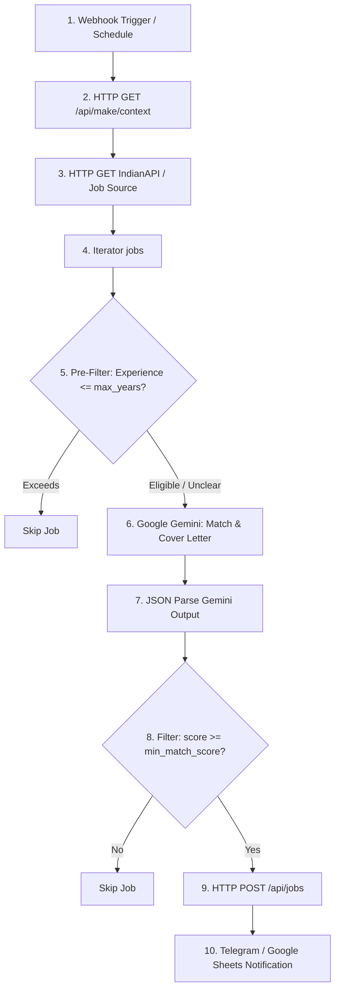

# 🤖 Make.com Automation Setup Guide

This guide provides step-by-step instructions for building the end-to-end automation scenario in [Make.com](https://www.make.com/) for the **Job Application Autopilot**.

---

## 🧭 Scenario Overview



---

## 📋 Prerequisites

1. Your backend URL (e.g. `https://your-backend.onrender.com` or local tunnel via `ngrok http 8000`).
2. Your `MAKE_API_KEY` configured in the backend `.env`.
3. A Google AI Studio API key for Gemini 1.5/2.5 Flash.
4. An IndianAPI key (or any RapidAPI/Job Board API key).
5. (Optional) A Telegram Bot Token & Chat ID for notifications.

---

## 🛠️ Module-by-Module Configuration

### Module 1: Trigger
- **Option A (Manual Dashboard Trigger):**
  - Type: **Custom Webhook**
  - Name: `Job Application Autopilot Webhook`
  - Copy the generated Webhook URL (e.g. `https://hook.eu2.make.com/xxxxxx`).
  - Paste this URL in your web dashboard under **Settings &rarr; Make.com Webhook URL**.
- **Option B (Scheduled Timer):**
  - Add a **Schedule** trigger (e.g., Every 6 or 12 hours).

---

### Module 2: Retrieve Active Resume & Filter Rules (HTTP)
- **Module:** `HTTP - Make a request`
- **URL:** `https://<YOUR_BACKEND_URL>/api/make/context`
- **Method:** `GET`
- **Headers:**
  - `X-API-Key`: `{{YOUR_MAKE_API_KEY}}`
- **Parse response:** `Yes`
- **Output variables available to subsequent modules:**
  - `active_role`: Currently selected target role (e.g. `"AI/ML Engineer"`)
  - `extracted_text`: Full plain text of the active resume for this role
  - `experience_filter.max_years_experience`: Configured max experience (e.g. `1`)
  - `experience_filter.filter_enabled`: Boolean flag (`true`/`false`)

---

### Module 3: Fetch Job Listings (HTTP)
- **Module:** `HTTP - Make a request`
- **URL:** `https://job-search-api.indianapi.in/jobs?keyword={{2.active_role}}&location=India` (or your preferred job source endpoint)
- **Method:** `GET`
- **Headers:**
  - `X-Api-Key`: `{{YOUR_INDIANAPI_KEY}}`
- **Parse response:** `Yes`

---

### Module 4: Iterator
- **Module:** `Iterator`
- **Array:** `{{3.data.jobs}}` (maps to each individual job item)

---

### Module 5: Pre-Filter Experience (Router / Filter)
- Set up a filter on the connection after the Iterator:
  - **Condition:** If `{{2.experience_filter.filter_enabled}}` equals `true`:
  - Allow if `{{4.experience}}` contains `fresher`, `entry`, `0-1`, `intern`, or is empty.

---

### Module 6: Google Gemini - Match Evaluation & Cover Letter
- **Module:** `Google Gemini / Create a completion` (or HTTP request to `https://generativelanguage.googleapis.com/v1beta/models/gemini-1.5-flash:generateContent`)
- **System Prompt:**
  ```text
  You are an expert technical recruiter and career coach.
  Evaluate the fit between the candidate's resume and the job posting.
  Strictly output a valid JSON object with no markdown wrappers or backticks.
  ```
- **User Prompt:**
  ```text
  Candidate Active Target Role: {{2.active_role}}
  Max Allowed Experience: {{2.experience_filter.max_years_experience}} year(s)

  Candidate Resume:
  {{2.extracted_text}}

  Job Opportunity:
  Title: {{4.title}}
  Company: {{4.company}}
  Location: {{4.location}}
  Experience Required: {{4.experience}}
  Job Description:
  {{4.description}}

  Return ONLY a raw JSON object with this exact structure:
  {
    "score": <float between 0.0 and 10.0 based on skill overlap>,
    "match_reason": "<1-2 sentence explanation of why this job matches or doesn't match>",
    "cover_letter": "<Professional, concise 3-paragraph personalized cover letter tailored to this role and company using candidate's projects>"
  }
  ```

---

### Module 7: Parse JSON
- **Module:** `JSON - Parse JSON`
- **JSON string:** `{{6.candidates[1].content.parts[1].text}}`

---

### Module 8: Score Filter
- **Filter Condition on link to Module 9:**
  - `{{7.score}}` **Greater than or equal to** `7.0` (or `{{settings.min_match_score}}`)

---

### Module 9: Save Qualified Job to Backend (HTTP POST)
- **Module:** `HTTP - Make a request`
- **URL:** `https://<YOUR_BACKEND_URL>/api/jobs`
- **Method:** `POST`
- **Headers:**
  - `Content-Type`: `application/json`
  - `X-API-Key`: `{{YOUR_MAKE_API_KEY}}`
- **Request content (Body):**
  ```json
  {
    "title": "{{4.title}}",
    "company": "{{4.company}}",
    "url": "{{4.url}}",
    "location": "{{4.location}}",
    "description": "{{4.description}}",
    "job_type": "{{4.job_type}}",
    "experience": "{{4.experience}}",
    "source": "IndianAPI",
    "score": {{7.score}},
    "match_reason": "{{7.match_reason}}",
    "cover_letter": "{{7.cover_letter}}",
    "status": "To Apply"
  }
  ```
- **Crucial Error Handler Directive:**
  - Right-click Module 9 in Make.com and select **Add error handler** &rarr; **Resume** (or **Ignore**).
  - Why? If a job is a duplicate (HTTP 409) or rejected by the experience filter (HTTP 422), the backend returns a clean rejection code. The error handler ensures the iterator continues processing the remaining jobs without stopping the scenario.

---

### Module 10: Notification (Telegram / Google Sheets)
- **Module:** `Telegram Bot - Send a Text Message or Reply`
- **Text:**
  ```text
  🎯 New Job Opportunity Discovered!

  Role: {{4.title}}
  Company: {{4.company}}
  Match Score: {{7.score}}/10
  Experience: {{4.experience}}

  Reason: {{7.match_reason}}

  Apply Link: {{4.url}}
  Dashboard: https://<YOUR_FRONTEND_URL>/jobs
  ```

---

## 🔒 Verification & Testing Checklist

1. **Verify Backend Connection:**
   Run a single manual test of Module 2 (`GET /api/make/context`) and verify it returns HTTP 200 with your resume's `extracted_text`.
2. **Verify Duplicate Prevention:**
   If the same job is sent twice, Module 9 should receive `409 Conflict` and ignore it.
3. **Verify Experience Filter:**
   If a job requires 5+ years and max experience is set to 1, Module 9 should receive `422 Unprocessable Entity` with a rejection message.
